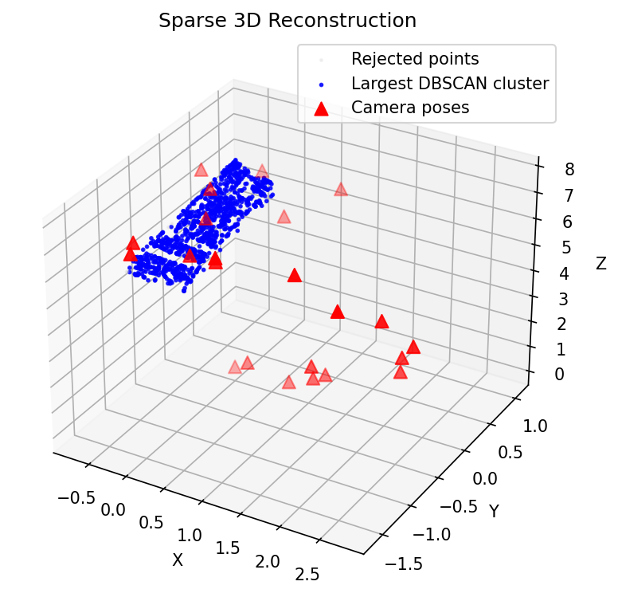
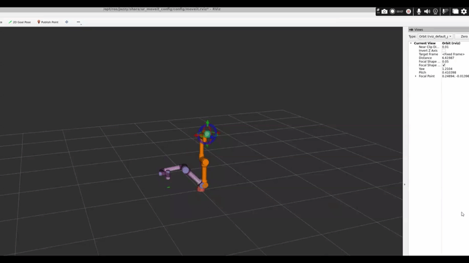

# 3D Reconstruction for Robotic Manipulation

A Python/OpenCV Structure-from-Motion (SfM) pipeline that reconstructs a sparse 3D point cloud from phone images, filters noise, segments the target object, and integrates it into a MoveItPy planning scene for collision-aware robotic manipulation.

**Technologies:** Python, OpenCV, SIFT, FLANN, RANSAC, triangulation, DBSCAN, ROS 2, MoveItPy.

## Results

- Processed **24 images** at 960 × 540 resolution.
- Reconstructed **11,377 3D points**, reduced to **10,931** after outlier filtering (3.92% removed).
- Identified a largest DBSCAN cluster of **1,119 points** for the exported object model.
- Achieved a camera calibration RMS reprojection error of **1.7312 pixels**.
- Exported a 3D point cloud (`model.ply`) and grasp position (`grasp.json`).
- Integrated the reconstructed object into MoveItPy for collision-aware pick-and-place planning.




## Directory Structure

```text
cwk1/
├── README.md
├── dataset/
├── calibration_dataset/
├── src/
│   └── main.py
└── ros2_ws/
    └── src/
        └── moveit_demo/
            ├── config/
            ├── launch/
            └── moveit_demo/
                └── move.py
```

The project root, cwk1, is the directory containing `src/`, `dataset/`, `calibration_dataset/`, and `ros2_ws/`.

## Pipeline

1. Calibrate the camera using checkerboard images.
2. Detect and match SIFT features using FLANN and Lowe's ratio test.
3. Estimate camera poses using the essential matrix and RANSAC, then triangulate matched features.
4. Remove outliers and segment the main point cluster using DBSCAN.
5. Export the reconstruction and grasp position for robotic motion planning.

## Running the Reconstruction

From the project root, cwk1, in a new terminal, run:

```bash
cd src
python3 main.py
```

The pipeline generates:

- `model.ply`
- `grasp.json`
- `reconstruction.png`

Before running the manipulation pipeline, ensure that `grasp.json` and `model.ply` are located in:

```text
ros2_ws/src/moveit_demo/config/
```

`grasp.json` is required by the current implementation. `model.ply` is included for completeness and potential future use. Copy the generated files into the configuration directory if necessary.

The reconstruction requires the input image and calibration datasets at the paths expected by the code.

## Running the Manipulation

The robotics component requires a configured ROS 2 Jazzy, MoveIt 2 and UR5e environment.

### 1. Build the Package

From the project root, in the same terminal aws before, run:

```bash
cd ros2_ws
source /opt/ros/jazzy/setup.bash
colcon build --packages-select moveit_demo
```

### 2. Start the UR5e Driver

In the same terminal:

```bash
source install/setup.bash

ros2 launch ur_robot_driver ur_control.launch.py \
    ur_type:=ur5e \
    use_mock_hardware:=true \
    robot_ip:=192.168.56.101
```

### 3. Launch MoveIt

Open a second terminal and navigate to the ROS workspace:

```bash
cd ~/ros2_ws
source /opt/ros/jazzy/setup.bash
source install/setup.bash

ros2 launch ur_moveit_config ur_moveit.launch.py \
    ur_type:=ur5e
```

### 4. Launch the Manipulation Application

Open a third terminal:

```bash
cd ~/ros2_ws
source /opt/ros/jazzy/setup.bash
source install/setup.bash

ros2 launch moveit_demo moveit_demo.launch.py > run.log 2>&1
```

The intended execution sequence is:

1. Move to the initial configuration.
2. Load the grasp position.
3. Add the object to the planning scene.
4. Approach and grasp the object.
5. Lift and transport the object.
6. Place the object.
7. Return to the home configuration.

## Limitations

- The reconstruction is sparse and depends on reliable feature matching.
- The largest DBSCAN cluster is assumed to represent the target object.
- The grasp position is predefined rather than estimated directly from the reconstructed point cloud.
- Collision-object dimensions are fixed rather than computed from the reconstructed model.

